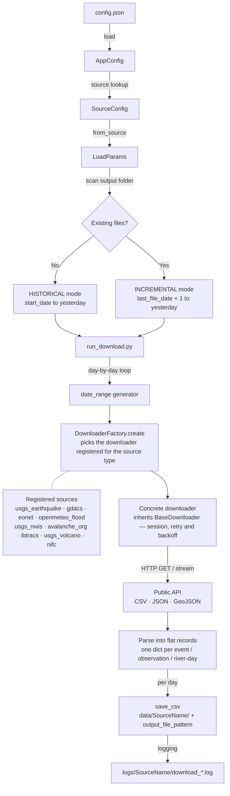

# GEO_Download

GIS Data Downloader — a Python 3.11 application for programmatically downloading geospatial data from public APIs and storing it as daily CSV files.

## Overview

GEO_Download fetches data from public geospatial APIs and saves it locally as dated CSV files. Currently supported sources:

| Source | Region coverage | Disaster types | API | Data |
|--------|-----------------|----------------|-----|------|
| USGS Earthquake | Global | Earthquakes (also quarry blasts, explosions) | [FDSN Event Query](https://earthquake.usgs.gov/fdsnws/event/1/query) | Seismic events (lat/lon, depth, magnitude, place) |
| GDACS | Global | Earthquakes (incl. tsunamis) · tropical cyclones · floods · volcanic eruptions · wildfires · droughts | [GDACS REST API](https://www.gdacs.org/gdacsapi/swagger/index.html) | Disaster events (country, alert level, severity, from/to dates) |
| NASA EONET | Global | Wildfires · severe storms · floods · volcanoes · earthquakes · droughts · landslides · sea & lake ice · temperature extremes | [EONET API v3](https://eonet.gsfc.nasa.gov/api/v3/) | Natural events (lat/lon, time-series tracks, magnitude, closed flag) |
| Open-Meteo Flood | Global — 126 major rivers | River floods (modelled discharge, forecast + historical) | [Flood API](https://open-meteo.com/en/docs/flood-api) | Daily river discharge (m³/s) for 126 major world rivers (GloFAS model, historical from 1984 + 30-day forecast) |
| USGS NWIS | United States — 1 gauge configured (Potomac R. near Washington, DC) | — (daily streamflow; flood & drought context) | [WaterServices API](https://waterservices.usgs.gov/nwis/iv/) · [NWS gauge API](https://api.water.noaa.gov/nwps/v1/docs/) | Daily streamflow (ft³/s) and peak gauge height (ft) with the NWS flood category (`no_flooding` … `major`) from USGS stream gauges (site-specific, US only, decades of history) |
| Avalanche.org | United States — 28 centers / 82+ zones | Avalanches (danger ratings 1-5) | [Avalanche.org API](https://api.avalanche.org/v2/public/products/map-layer) | Daily avalanche danger ratings (1-5) for 82+ forecast zones of 28 US avalanche centers (zone, center, travel advice, zone centroid lat/lon) |
| IBTrACS | Global — all ocean basins | Tropical cyclones (hurricanes / typhoons) | [NOAA IBTrACS](https://www.ncei.noaa.gov/products/international-best-track-archive) | Global tropical cyclone best-track data — storm position, wind speed, pressure, landfall info (all ocean basins, 1842-present) |
| USGS Volcano | United States & territories — AK, HI, CNMI, CA, Cascades, Yellowstone observatories | Volcanic eruptions & unrest (alert notices) | [HANS API](https://volcanoes.usgs.gov/hans-public/api/volcano) · NCEI HazEL API | US volcano alert status — elevated alerts (ADVISORY/WATCH/WARNING) with observatory info, notice links and resolved notice details (coordinates, region, full notice type, status line), plus each volcano's significant-eruption record from the NCEI/WDS Significant Volcanic Eruptions Database (VEI, casualties, damage) |
| NIFC | United States — CONUS, Alaska & Puerto Rico | Wildfires (incl. prescribed fires) | [WFIGS ArcGIS](https://services3.arcgis.com/T4QMspbfLg3qTGWY/arcgis/rest/services/WFIGS_Interagency_Perimeters_Current/FeatureServer) | US wildland fire perimeters — incident name, location, acres, containment, jurisdiction, unit name |

**Region coverage** — the geographic footprint of the rows that end up in `data/`. It is set by the provider's mandate (global vs US-only) and, where applicable, narrowed by `config.json`: USGS NWIS downloads just the gauges listed in `sites` (one site by default), while USGS Earthquake, GDACS, EONET, Open-Meteo Flood and IBTrACS carry worldwide records.

All sources support two loading modes:

- **Historical** — bulk download from a configured start date to yesterday (initial load).
- **Incremental** — download only the days missing since the last downloaded file (catch-up runs).

The architecture is extensible: new data sources can be added by implementing a downloader class that inherits from `BaseDownloader`, without modifying the core orchestration logic.

## Data inventory

How much data sits under `data/` right now — the number of daily CSV files each source has downloaded and the total number of records inside them (the folder is gitignored, so this is a snapshot from the last regeneration).

```bash
python run_source_counts.py
```

The script counts every source of `config.json`, writes the rows to [source_counts.csv](source_counts.csv) and rewrites the table below between the `source_counts` markers, so the README and the CSV always agree:

<!-- source_counts:start -->
| Source | Files | Records |
|--------|------:|--------:|
| USGS_Earthquake | 64 | 18,279 |
| GDACS | 64 | 17,442 |
| EONET | 63 | 324 |
| OpenMeteo_Flood | 64 | 14,208 |
| USGS_NWIS | 64 | 115 |
| Avalanche_ORG | 64 | 10,766 |
| IBTrACS | 64 | 1,766 |
| USGS_Volcano | 38 | 101 |
| NIFC | 62 | 396 |
| **Total** | **547** | **63,397** |
<!-- source_counts:end -->

## Features

- **Automated date management** — automatically determines historical vs incremental mode by scanning the output folder for existing files.
- **Day-by-day download** — each day's data is saved as a separate CSV, making files easy to manage and inspect.
- **Retry with backoff** — HTTP requests use exponential backoff (5 retries) with automatic retry on 429 and 5xx status codes.
- **Abstract base class** — `BaseDownloader` provides shared session setup, JSON fetching, and CSV parsing; new sources only implement `download_by_date_range()`.
- **Factory/Registry pattern** — new data sources are added via self-registering downloader classes.
- **Reverse-geocode stamping** — `geocode_country` / `geocode_state` are reverse-geocoded at download time by `reverse_geocode.py` and appended to the downloaded CSVs through the shared lookup `data/reverse_geocode.csv`, so GEO_ETL never queries the geocoding API itself; the [Data sources](docs/data-sources.md) tables say which columns each source gets.
- **Threshold reference** — `run_openmeteo_thresholds.py` pulls each river's baseline window in one request and writes its discharge percentiles (p50/p90/p95/p99) to `data/openmeteo_discharge_thresholds.csv`, the baseline GEO_ETL joins on every day to fill `danger_rating` and `other_metrics`; `run_download.py OpenMeteo_Flood` creates the file when it is missing and leaves it alone afterwards.
- **Frozen Pydantic models** — all configuration and parameter objects are immutable.
- **Data inventory** — `run_source_counts.py` counts the files and records every source has under `data/`, writes them to [source_counts.csv](source_counts.csv) and refreshes the [Data inventory](#data-inventory) table in this README.
- **Structured logging** — each run produces a timestamped log file under `logs/<SourceName>/`; the folder is created atomically, so concurrent Airflow tasks sharing it cannot race.
- **Fails on an empty run** — a run exits `0` only when at least one CSV was written (or the local data is already current); a run that requested days but saved nothing raises `RuntimeError` (traceback, exit code `1`), so a chained pipeline (GEO_E2E) stops instead of ingesting stale files.
- **CLI interface** — source selection via command-line arguments.

## Tech Stack

| Component        | Technology                                  |
|------------------|---------------------------------------------|
| Language         | Python 3.11                                 |
| Data Validation  | Pydantic >= 2.0.0                           |
| HTTP Client      | requests >= 2.31.0 (with urllib3 retry)     |
| CSV Processing   | Standard library `csv` + `io.StringIO`       |
| Testing          | pytest >= 7.0.0                             |
| Linting/Format   | ruff >= 0.6 (lint + format + import sort)   |
| Check runner     | tox >= 4.0 (isolated lint/test/typecheck)   |
| Type checking    | mypy (run via `tox -e typecheck`)           |
| Environment      | Conda                                       |

## Documentation

| Document | Contents |
|----------|----------|
| [Data sources](docs/data-sources.md) | Every CSV the app produces — file pattern, row grain and a field-by-field description of all 9 sources (176 IBTrACS columns included). |
| [Configuration](docs/configuration.md) | Full `config.json` reference — per-source settings, dates, output folders. |
| [Architecture](docs/architecture.md) | Project layout and how to add a new data source in 4 steps. |
| [Memory leaks investigation 2026-11-23](docs/memory-leaks-investigation-2026-11-23.md) | Host vs container attribution and the downloader session-close fix. |
| [Memory leaks investigation 2026-11-24](docs/memory-leaks-investigation-2026-11-24.md) | Follow-up after the daily run: short-lived downloads, flat containers, desktop growth. |
| [Development](docs/development.md) | Running the tests, Ruff lint/format, tox environments and PyCharm integration. |

## Usage

### Docker

GEO_Download does not run as a separate container: its runtime files are baked into
the **`geo_airflow_spark`** image by the Compose stack in [GEO_E2E](../GEO_E2E) and
invoked by the Airflow `DOWNLOAD` tasks inside the scheduler container.

- The `geo_download_311` conda environment lives at `/opt/conda/envs/geo_download_311`.
- The project is copied to `/opt/geo/GEO_Download` (runtime files only — no docs,
  tests, tox/mypy/lint setup).
- `data/` is the host folder bind-mounted at `/opt/geo/GEO_Download/data` (`GEO_DATA_DIR`
  in `GEO_E2E/.env`), so downloaded CSV files are immediately visible in the local repo and
  to Spark executors. GEO_ETL's PySpark DATA_SOURCE_FILE job publishes the CSV inventory from the
  Spark side to `geo.data_source_files`, which GEO_API serves through `GET /data-source-files`.
  The old `geo_data` named volume is no longer used and is left untouched.
- Set the Supabase credentials in `GEO_E2E/.env` before starting the stack; Airflow
  defaults to `airflow_admin` / `airflow_admin`.

```bash
cd ../GEO_E2E
./up.sh -d --build          # preflight (six repos + Supabase .env), then compose up
```

After changing GEO_Download, rebuild the image:

```bash
docker compose build airflow-init
./up.sh -d
```

### Setup

```bash
conda env create -f environment.yml
conda activate geo_download_311
```

### Run

```bash
python run_download.py <source_name>
```

Where `<source_name>` matches a key in `config.json` (e.g. `USGS_Earthquake`, `GDACS`, `EONET`, `OpenMeteo_Flood`, `USGS_NWIS`, `Avalanche_ORG`, `IBTrACS`, `USGS_Volcano`, `NIFC`).

Only enabled sources are accepted as valid arguments. The application will:

1. Load configuration from `config.json`.
2. Determine whether to run in historical or incremental mode by checking existing files in the output folder.
3. Download data for each day in the date range.
4. Save each day's data to a separate CSV file.

### Examples

**Earthquake data:**

```bash
python run_download.py USGS_Earthquake
```

```
---- USGS_Earthquake Downloader ----

Source name: USGS_Earthquake
Source type: usgs_earthquake
API URL: https://earthquake.usgs.gov/fdsnws/event/1/query
Output folder: data/USGS_Earthquake
Output file pattern: usgs_earthquakes_{date}.csv
Load type: INCREMENTAL
Start date: 2026-09-14 00:00:00
End date: 2026-09-14 00:00:00

Downloading data for 2026-09-14.
File data/USGS_Earthquake/usgs_earthquakes_2026-09-14.csv saved. Records: 142.

Done.
```

**Global disaster data (GDACS):**

```bash
python run_download.py GDACS
```

```
---- GDACS Downloader ----

Source name: GDACS
Source type: gdacs
API URL: https://www.gdacs.org/gdacsapi/api/Events/geteventlist/SEARCH
Output folder: data/GDACS
Output file pattern: gdacs_disasters_{date}.csv
Load type: HISTORICAL
Start date: 2026-09-01 00:00:00
End date: 2026-09-14 00:00:00

Downloading GDACS events for 2026-09-01 to 2026-09-01.
  Page 1: 100 events
  Page 2: 47 events
Downloaded 147 GDACS events total
File data/GDACS/gdacs_disasters_2026-09-01.csv saved. Records: 147.

Done.
```

**Natural events (NASA EONET):**

```bash
python run_download.py EONET
```

**River discharge / flood monitoring (Open-Meteo Flood):**

```bash
python run_download.py OpenMeteo_Flood
```

The download above already builds `data/openmeteo_discharge_thresholds.csv` when it is missing; refresh the reference whenever the window grows:

```bash
python run_openmeteo_thresholds.py
```

**US streamflow (USGS NWIS):**

```bash
python run_download.py USGS_NWIS
```

**Global tropical cyclones (IBTrACS):**

```bash
python run_download.py IBTrACS
```

**USGS volcano alerts:**

```bash
python run_download.py USGS_Volcano
```

**US wildland fires (NIFC):**

```bash
python run_download.py NIFC
```

**US avalanche forecasts (Avalanche.org):**

```bash
python run_download.py Avalanche_ORG
```

## Dataflow



## Related Projects

GEO_Download is the first stage of the GIS data pipeline. The six projects sit as siblings under `GeographicData/`:

- **[GEO_ETL](../GEO_ETL)** — PySpark ETL that loads the CSVs written here into Supabase; its `data.directory` is `../GEO_Download/data`.
- **[GEO_E2E](../GEO_E2E)** — Airflow orchestrator that schedules `run_download.py`; also hosts the `docker-compose.yaml` running the Spark cluster GEO_ETL connects to.
- **[GEO_API](../GEO_API)** — FastAPI layer serving the finished Supabase data (`geo.data_quality`, `geo.union_etl`, `geo.data_source_files`) over REST, including the `GET /data-source-files` CSV inventory.
- **[GEO_APP](../GEO_APP)** — React dashboard rendering what GEO_API returns, including the Data Source Files view.
- **[GEO_Visual](../GEO_Visual)** — Streamlit dashboard served by the `geo_streamlit` container in GEO_E2E, reading the finished Supabase views directly (read-only SQL) for interactive analysis; it does not consume the CSVs or GEO_API.
