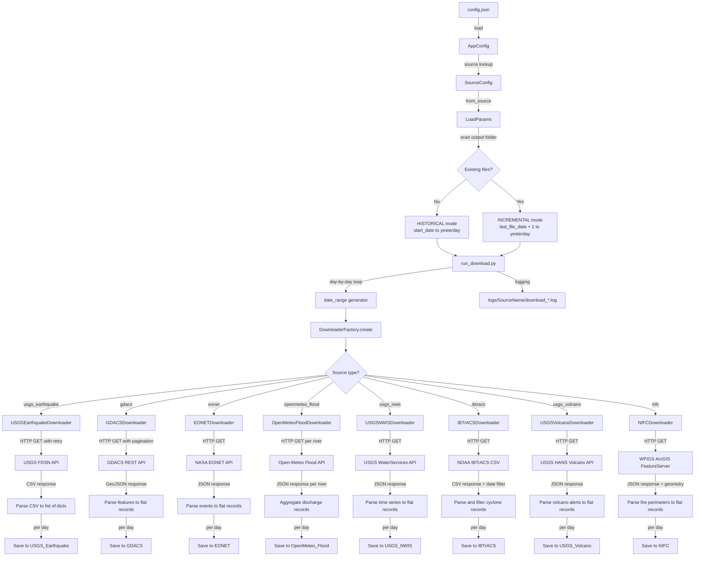

# GEO_Download

GIS Data Downloader — a Python 3.11 application for programmatically downloading geospatial data from public APIs and storing it as daily CSV files.

## Overview

GEO_Download fetches data from public geospatial APIs and saves it locally as dated CSV files. Currently supported sources:

| Source | API | Data |
|--------|-----|------|
| USGS Earthquake | [FDSN Event Query](https://earthquake.usgs.gov/fdsnws/event/1/query) | Seismic events (lat/lon, depth, magnitude, place) |
| GDACS | [GDACS REST API](https://www.gdacs.org/gdacsapi/swagger/index.html) | Global disasters — earthquakes, cyclones, floods, volcanoes, wildfires, droughts (country, alert level, severity) |
| NASA EONET | [EONET API v3](https://eonet.gsfc.nasa.gov/api/v3/) | Natural events — wildfires, storms, floods, volcanoes, earthquakes, drought, landslides, sea ice, temperature extremes (lat/lon, time-series tracks, magnitude) |
| Open-Meteo Flood | [Flood API](https://open-meteo.com/en/docs/flood-api) | Daily river discharge (m³/s) for 126 major world rivers (GloFAS model, historical from 1984 + 30-day forecast) |
| USGS NWIS | [WaterServices API](https://waterservices.usgs.gov/nwis/dv/) | Daily streamflow (ft³/s) from USGS stream gauges (site-specific, US only, decades of history) |
| IBTrACS | [NOAA IBTrACS](https://www.ncei.noaa.gov/products/international-best-track-archive) | Global tropical cyclone best-track data — storm position, wind speed, pressure, landfall info (all ocean basins, 1842-present) |
| USGS Volcano | [HANS API](https://volcanoes.usgs.gov/hans-public/api/volcano) | US volcano alert status — elevated alerts (ADVISORY/WATCH/WARNING) with observatory info and notice links |
| NIFC | [WFIGS ArcGIS](https://services3.arcgis.com/T4QMspbfLg3qTGWY/arcgis/rest/services/WFIGS_Interagency_Perimeters_Current/FeatureServer) | US wildland fire perimeters — incident name, location, acres, containment, jurisdiction |

All sources support two loading modes:

- **Historical** — bulk download from a configured start date to yesterday (initial load).
- **Incremental** — download only the days missing since the last downloaded file (catch-up runs).

The architecture is extensible: new data sources can be added by implementing a downloader class that inherits from `BaseDownloader`, without modifying the core orchestration logic.

## Features

- **Automated date management** — automatically determines historical vs incremental mode by scanning the output folder for existing files.
- **Day-by-day download** — each day's data is saved as a separate CSV, making files easy to manage and inspect.
- **Retry with backoff** — HTTP requests use exponential backoff (5 retries) with automatic retry on 429 and 5xx status codes.
- **Abstract base class** — `BaseDownloader` provides shared session setup, JSON fetching, and CSV parsing; new sources only implement `download_by_date_range()`.
- **Factory/Registry pattern** — new data sources are added via self-registering downloader classes.
- **Frozen Pydantic models** — all configuration and parameter objects are immutable.
- **Structured logging** — each run produces a timestamped log file under `logs/<SourceName>/`.
- **CLI interface** — source selection via command-line arguments.

## Tech Stack

| Component        | Technology                                  |
|------------------|---------------------------------------------|
| Language         | Python 3.11                                 |
| Data Validation  | Pydantic >= 2.0.0                           |
| HTTP Client      | requests >= 2.31.0 (with urllib3 retry)     |
| CSV Processing   | Standard library `csv` + `io.StringIO`       |
| Testing          | pytest >= 7.0.0                             |
| Environment      | Conda                                       |

## Project Structure

<details>
<summary style="font-size: 1.1em"><i>Click to expand</i></summary>

```
GEO_Download/
├── run_download.py            # Entry point — CLI parsing, orchestration, CSV saving
├── config.json                # Data source configuration
├── downloader_factory.py      # Factory/registry for downloader classes
├── util.py                    # Logger setup, date range generator, file date detection
├── environment.yml            # Conda environment definition
├── model/                     # Pydantic models and enums
│   ├── __init__.py
│   ├── config.py              # AppConfig — loads config.json
│   ├── source_config.py       # SourceConfig — per-source settings
│   ├── download_params.py     # DownloadParams — download parameters
│   ├── load_params.py         # LoadParams — determines load type and date range
│   └── e_source_type.py       # ESourceType enum (usgs_earthquake, gdacs, eonet, openmeteo_flood, usgs_nwis, ibtracs, usgs_volcano, nifc)
│   └── e_load_type.py         # ELoadType enum (HISTORICAL / INCREMENTAL)
├── downloader/                # Downloader classes (base + concrete implementations)
│   ├── __init__.py            # Imports + factory registrations
│   ├── base.py                # BaseDownloader — abstract base class
│   ├── usgs_earthquake.py     # USGSEarthquakeDownloader
│   ├── gdacs.py               # GDACSDownloader
│   ├── eonet.py               # EONETDownloader
│   ├── openmeteo_flood.py     # OpenMeteoFloodDownloader
│   ├── usgs_nwis.py           # USGSNWISDownloader
│   ├── ibtracs.py             # IBTrACSDownloader
│   ├── usgs_volcano.py       # USGSVolcanoDownloader
│   ├── nifc.py                # NIFCDownloader
├── test/                      # Unit tests
│   ├── test_base_downloader.py
│   ├── test_models.py
│   ├── test_downloader_factory.py
│   ├── test_util.py
│   ├── test_usgs_downloader.py
│   ├── test_gdacs_downloader.py
│   ├── test_eonet_downloader.py
│   ├── test_openmeteo_flood_downloader.py
│   ├── test_usgs_nwis_downloader.py
│   ├── test_ibtracs_downloader.py
├── data/                      # Downloaded CSV files (per source subfolder)
│   ├── USGS_Earthquake/
│   ├── GDACS/
│   ├── EONET/
│   ├── OpenMeteo_Flood/
│   ├── USGS_NWIS/
│   ├── IBTrACS/
│   ├── USGS_Volcano/
│   ├── NIFC/
│   └── rivers.json            # River definitions (126 major world rivers)
└── logs/                      # Timestamped log files (per source subfolder)
    ├── USGS_Earthquake/
    ├── GDACS/
    ├── EONET/
    ├── OpenMeteo_Flood/
    ├── USGS_NWIS/
    ├── IBTrACS/
    ├── USGS_Volcano/
    ├── NIFC/
```

</details>

## Configuration

The application is configured via `config.json`. Each data source is defined under the `sources` key:

<details>
<summary style="font-size: 1.1em"><i>Click to expand</i></summary>

```json
{
  "sources": {
    "USGS_Earthquake": {
      "type": "usgs_earthquake",
      "enabled": true,
      "api_url": "https://earthquake.usgs.gov/fdsnws/event/1/query",
      "start_date": "2026-09-01",
      "output_folder": "data/USGS_Earthquake",
      "output_file_pattern": "usgs_earthquakes_{date}.csv",
      "is_date_to_previous_day": true
    },
    "GDACS": {
      "type": "gdacs",
      "enabled": true,
      "api_url": "https://www.gdacs.org/gdacsapi/api/Events/geteventlist/SEARCH",
      "start_date": "2026-09-01",
      "output_folder": "data/GDACS",
      "output_file_pattern": "gdacs_disasters_{date}.csv",
      "is_date_to_previous_day": true
    },
    "EONET": {
      "type": "eonet",
      "enabled": true,
      "api_url": "https://eonet.gsfc.nasa.gov/api/v3/events",
      "start_date": "2026-09-01",
      "output_folder": "data/EONET",
      "output_file_pattern": "eonet_events_{date}.csv",
      "is_date_to_previous_day": true
    },
    "OpenMeteo_Flood": {
      "type": "openmeteo_flood",
      "enabled": true,
      "api_url": "https://flood-api.open-meteo.com/v1/flood",
      "start_date": "2026-09-01",
      "output_folder": "data/OpenMeteo_Flood",
      "output_file_pattern": "openmeteo_rivers_{date}.csv",
      "is_date_to_previous_day": true
    },
    "USGS_NWIS": {
      "type": "usgs_nwis",
      "enabled": true,
      "api_url": "https://waterservices.usgs.gov/nwis/dv/",
      "start_date": "2026-09-01",
      "output_folder": "data/USGS_NWIS",
      "output_file_pattern": "usgs_streamflow_{date}.csv",
      "is_date_to_previous_day": true
    },
    "IBTrACS": {
      "type": "ibtracs",
      "enabled": true,
      "api_url": "https://www.ncei.noaa.gov/data/international-best-track-archive-for-climate-stewardship-ibtracs/v04r01/access/csv",
      "start_date": "2026-09-01",
      "output_folder": "data/IBTrACS",
      "output_file_pattern": "ibtracs_cyclones_{date}.csv",
      "is_date_to_previous_day": true
    },
    "USGS_Volcano": {
      "type": "usgs_volcano",
      "enabled": true,
      "api_url": "https://volcanoes.usgs.gov/hans-public/api/volcano",
      "start_date": "2026-09-01",
      "output_folder": "data/USGS_Volcano",
      "output_file_pattern": "usgs_volcanoes_{date}.csv",
      "is_date_to_previous_day": true
    },
    "NIFC": {
      "type": "nifc",
      "enabled": true,
      "api_url": "https://services3.arcgis.com/T4QMspbfLg3qTGWY/arcgis/rest/services/WFIGS_Interagency_Perimeters_Current/FeatureServer/0/query",
      "start_date": "2026-09-01",
      "output_folder": "data/NIFC",
      "output_file_pattern": "nifc_fires_{date}.csv",
      "is_date_to_previous_day": true
    }
  }
}
```

</details>

| Field                    | Description                                                             |
|--------------------------|-------------------------------------------------------------------------|
| `type`                   | Source type identifier — maps to a registered downloader via `ESourceType` enum. |
| `enabled`                | Whether this source is active and available for download.               |
| `api_url`                | Base API URL used by the downloader to construct query requests.        |
| `start_date`             | Earliest date to download from (used in historical mode).               |
| `output_folder`          | Directory where CSV files are saved.                                    |
| `output_file_pattern`    | Filename pattern — `{date}` is replaced with `YYYY-MM-DD`.              |
| `is_date_to_previous_day`| If `true`, the end date is yesterday; if `false`, it's today.           |
| `params`                 | Additional source-specific parameters passed to the downloader constructor. |

## Usage

### Setup

```bash
conda env create -f environment.yml
conda activate geo_download_311
```

### Run

```bash
python run_download.py <source_name>
```

Where `<source_name>` matches a key in `config.json` (e.g. `USGS_Earthquake`, `GDACS`, `EONET`, `OpenMeteo_Flood`, `USGS_NWIS`, `IBTrACS`, `USGS_Volcano`, `NIFC`).

Only enabled sources are accepted as valid arguments. The application will:

1. Load configuration from `config.json`.
2. Determine whether to run in historical or incremental mode by checking existing files in the output folder.
3. Download data for each day in the date range.
4. Save each day's data to a separate CSV file.

### Examples

**Earthquake data:**

```bash
python run_download.py USGS_Earthquake
```

```
---- USGS_Earthquake Downloader ----

Source name: USGS_Earthquake
Source type: usgs_earthquake
API URL: https://earthquake.usgs.gov/fdsnws/event/1/query
Output folder: data/USGS_Earthquake
Output file pattern: earthquakes_{date}.csv
Load type: INCREMENTAL
Start date: 2026-09-14 00:00:00
End date: 2026-09-13 00:00:00

Downloading data for 2026-09-14.
File data/USGS_Earthquake/usgs_earthquakes_2026-09-14.csv saved. Records: 142.

Done.
```

**Global disaster data (GDACS):**

```bash
python run_download.py GDACS
```

**Natural events (NASA EONET):**

```bash
python run_download.py EONET
```

**River discharge / flood monitoring (Open-Meteo Flood):**

```bash
python run_download.py OpenMeteo_Flood
```

**US streamflow (USGS NWIS):**

```bash
python run_download.py USGS_NWIS
```

**Global tropical cyclones (IBTrACS):**

```bash
python run_download.py IBTrACS
```

**USGS volcano alerts:**

```bash
python run_download.py USGS_Volcano
```

**US wildland fires (NIFC):**

```bash
python run_download.py NIFC
```

```
---- GDACS Downloader ----

Source name: GDACS
Source type: gdacs
API URL: https://www.gdacs.org/gdacsapi/api/Events/geteventlist/SEARCH
Output folder: data/GDACS
Output file pattern: disasters_{date}.csv
Load type: HISTORICAL
Start date: 2026-09-01 00:00:00
End date: 2026-09-14 00:00:00

Downloading GDACS events for 2026-09-01 to 2026-09-01.
  Page 1: 100 events
  Page 2: 47 events
Downloaded 147 GDACS events total
File data/GDACS/gdacs_disasters_2026-09-01.csv saved. Records: 147.

Done.
```

## Data Output

Downloaded files are saved as CSV with one file per day, named by date.

### USGS Earthquake

- **Location:** `data/USGS_Earthquake/usgs_earthquakes_YYYY-MM-DD.csv`
- **Columns:** 23 fields including `time`, `latitude`, `longitude`, `depth`, `mag`, `magType`, `place`, `type`, `status`, and more.

### GDACS (Global Disasters)

- **Location:** `data/GDACS/gdacs_disasters_YYYY-MM-DD.csv`
- **Columns:** 17 fields — `event_type`, `event_id`, `event_name`, `alert_level`, `country`, `country_code`, `latitude`, `longitude`, `from_date`, `to_date`, `date_modified`, `severity`, `severity_text`, `severity_unit`, `source`, `report_url`, `is_current`.
- **Event types:** EQ (earthquake), TC (tropical cyclone), FL (flood), VO (volcano), WF (wildfire), DR (drought).

### NASA EONET (Natural Events)

- **Location:** `data/EONET/eonet_events_YYYY-MM-DD.csv`
- **Columns:** 17 fields — `event_id`, `event_name`, `category_id`, `category_name`, `description`, `source_id`, `source_url`, `latitude`, `longitude`, `event_date`, `magnitude_value`, `magnitude_unit`, `closed`, `geometry_count`, `last_latitude`, `last_longitude`, `last_date`.
- **Categories:** wildfires, severeStorms, floods, volcanoes, earthquakes, drought, landslides, seaLakeIce, snow, tempExtremes, dustHaze, manmade, waterColor.

### Open-Meteo Flood (River Discharge)

- **Location:** `data/OpenMeteo_Flood/openmeteo_rivers_YYYY-MM-DD.csv`
- **Columns:** 6 fields — `river_name`, `country`, `latitude`, `longitude`, `date`, `discharge_m3s`.
- **Coverage:** 126 major world rivers across all continents. Based on GloFAS v4 model (5km resolution).
- **River list:** Defined in `data/rivers.json` — editable to add/remove monitoring locations.

### USGS NWIS (US Streamflow)

- **Location:** `data/USGS_NWIS/usgs_streamflow_YYYY-MM-DD.csv`
- **Columns:** 9 fields — `site_id`, `site_name`, `parameter_code`, `date`, `value`, `unit`, `qualifiers`, `latitude`, `longitude`.
- **Coverage:** USGS stream gauges across the United States. Configure via `sites` parameter in constructor (comma-separated site numbers).
- **Default site:** USGS-01646500 (Potomac River near Washington DC).

### IBTrACS (Global Tropical Cyclones)

- **Location:** `data/IBTrACS/ibtracs_cyclones_YYYY-MM-DD.csv`
- **Columns:** 11 fields — `SEASON`, `BASIN`, `SUBBASIN`, `ISO_TIME`, `NATURE`, `LAT`, `LON`, `WMO_WIND`, `WMO_PRES`, `DIST2LAND`, `LANDFALL`.
- **Coverage:** Global tropical cyclone best-track data from all ocean basins (NA, EP, WP, NI, SI, SP). Data from 1842 to present, updated 3x/week.
- **Wind speed:** Maximum sustained wind in knots (WMO_WIND). 35 kt = tropical storm, 64 kt = hurricane/cyclone/typhoon.
- **Dataset options:** Default uses `last3years` for efficient incremental downloads. Can be configured to `all` for full historical data.

### USGS Volcano

- **Location:** `data/USGS_Volcano/usgs_volcanoes_YYYY-MM-DD.csv`
- **Columns:** 18 fields — `volcano_id`, `volcano_name`, `volcano_type`, `alert_level`, `notice_date`, `notice_summary`, `notice_link`, `observatory`, `state`, `country`, `latitude`, `longitude`, `elevation`, `eruption_status`, `last_eruption`, `is_monitored`, `monitoring_status`, `source_url`.
- **Coverage:** US volcanoes with elevated alert status (ADVISORY, WATCH, WARNING). Data from USGS HANS Public API, filtered by alert status.
- **Note:** Only includes volcanoes with elevated alerts; clear/normal status volcanoes are not included in daily downloads.

### NIFC (US Wildland Fires)

- **Location:** `data/NIFC/nifc_fires_YYYY-MM-DD.csv`
- **Columns:** 16 fields — `incident_name`, `irwin_id`, `fire_number`, `acres`, `percent_contained`, `fire_type`, `fire_type_label`, `jurisdiction`, `jurisdiction_label`, `state`, `po_method`, `latitude`, `longitude`, `poly_date`, `created_on`, `modified_on`.
- **Coverage:** US wildland fire perimeters from the Wildland Fire Interagency Geospatial Services (WFIGS) system. Includes all active incidents with perimeter polygons.
- **Data:** Incident name, IRWIN ID, fire size, containment percentage, type, jurisdiction, and geographic coordinates.

## Testing

```bash
pytest test/
```

Tests cover:
- **Base downloader** — ABC instantiation guard, session creation with retry, `_get_json()` success/error.
- **Model validation** — `SourceConfig`, `AppConfig`, `LoadParams` (historical vs incremental logic, `is_date_to_previous_day` flag).
- **Factory pattern** — registration, creation, overwrite, error cases.
- **Utilities** — `date_range()` generator, `get_recent_file_date()` file scanning.
- **Earthquake downloader** — mocked HTTP for success, empty, HTTP error, connection error, URL construction.
- **GDACS downloader** — record building from GeoJSON, pagination, empty/no-data handling.
- **EONET downloader** — event parsing (Point/Polygon geometry), closed events, missing geometry, empty/no-data handling.
- **Open-Meteo Flood downloader** — river discharge queries, null value handling, multi-river aggregation.
- **USGS NWIS downloader** — legacy WaterServices API, time series parsing, site metadata extraction.
- **IBTrACS downloader** — CSV parsing with units row skip, date filtering, custom dataset selection, error handling.
- **USGS Volcano downloader** — HANS API response parsing, alert filtering, notice URL construction.
- **NIFC downloader** — ArcGIS FeatureServer query, polygon geometry parsing, date/time filtering.

## Dataflow

<details>
<summary style="font-size: 1.1em"><i>Click to expand</i></summary>



</details>

## Extensibility

To add a new data source:

1. **Add a value to `ESourceType`** in `model/e_source_type.py`.
2. **Create a downloader class** in `downloader/` (e.g. `downloader/new_source.py`) inheriting from `BaseDownloader` and implementing `download_by_date_range()`.
3. **Register the downloader** in `downloader/__init__.py` via `DownloaderFactory.register()`.
4. **Add a source entry** to `config.json` with the new type.

The base class provides shared infrastructure (session with retry, `_get_json()`, `_download_csv()`), so new sources only need to implement the date-range download logic.
