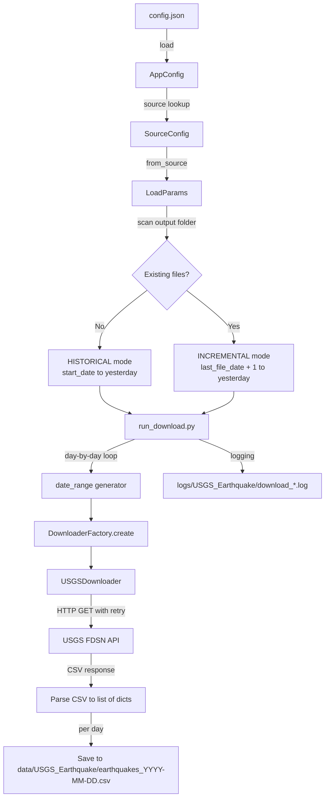

# GEO_Download

GIS Data Downloader — a Python 3.11 application for programmatically downloading geospatial data from public APIs and storing it as daily CSV files.

## Overview

GEO_Download fetches earthquake data from the [USGS Earthquake Hazards Program](https://earthquake.usgs.gov/) FDSN Event Query API and saves it locally as dated CSV files. It supports two loading modes:

- **Historical** — bulk download from a configured start date to yesterday (initial load).
- **Incremental** — download only the days missing since the last downloaded file (catch-up runs).

The architecture is extensible: new data sources can be added by registering a downloader class with the factory, without modifying the core orchestration logic.

## Features

- **Automated date management** — automatically determines historical vs incremental mode by scanning the output folder for existing files.
- **Day-by-day download** — each day's data is saved as a separate CSV, making files easy to manage and inspect.
- **Retry with backoff** — HTTP requests use exponential backoff (5 retries) with automatic retry on 429 and 5xx status codes.
- **Factory/Registry pattern** — new data sources are added via self-registering downloader packages.
- **Frozen Pydantic models** — all configuration and parameter objects are immutable.
- **Structured logging** — each run produces a timestamped log file under `logs/`.
- **CLI interface** — source selection via command-line arguments.

## Tech Stack

| Component        | Technology                                  |
|------------------|---------------------------------------------|
| Language         | Python 3.11                                 |
| Data Validation  | Pydantic >= 2.0.0                           |
| HTTP Client      | requests >= 2.31.0 (with urllib3 retry)     |
| CSV Processing   | Standard library `csv` + `io.StringIO`       |
| Testing          | pytest >= 7.0.0                             |
| Environment      | Conda                                       |

## Project Structure

```
GEO_Download/
├── run_download.py            # Entry point — CLI parsing, orchestration, CSV saving
├── config.json                # Data source configuration
├── downloader_factory.py      # Factory/registry for downloader classes
├── util.py                    # Logger setup, date range generator, file date detection
├── environment.yml            # Conda environment definition
├── model/                     # Pydantic models and enums
│   ├── __init__.py
│   ├── config.py              # AppConfig — loads config.json
│   ├── source_config.py       # SourceConfig — per-source settings
│   ├── download_params.py     # DownloadParams — download parameters
│   ├── load_params.py         # LoadParams — determines load type and date range
│   ├── e_source_type.py       # ESourceType enum (e.g. usgs_earthquake)
│   └── e_load_type.py         # ELoadType enum (HISTORICAL / INCREMENTAL)
├── usgs/                      # USGS earthquake data downloader
│   ├── __init__.py            # Registers USGSDownloader with the factory
│   └── downloader.py          # USGSDownloader — HTTP download + CSV parsing
├── test/                      # Unit tests
│   ├── test_models.py
│   ├── test_downloader_factory.py
│   ├── test_util.py
│   └── test_usgs_downloader.py
├── data/                      # Downloaded CSV files (per source subfolder)
│   └── USGS_Earthquake/
└── logs/                      # Timestamped log files (per source subfolder)
    └── USGS_Earthquake/
```

## Configuration

The application is configured via `config.json`. Each data source is defined under the `sources` key:

```json
{
  "sources": {
    "USGS_Earthquake": {
      "type": "usgs_earthquake",
      "enabled": true,
      "api_url": "https://earthquake.usgs.gov/fdsnws/event/1/query",
      "feed_url": "https://earthquake.usgs.gov/earthquakes/feed/v1.0/summary/all_day.csv",
      "start_date": "2026-09-01",
      "output_folder": "data/USGS_Earthquake",
      "output_file_pattern": "earthquakes_{date}.csv",
      "is_date_to_previous_day": true
    }
  }
}
```

| Field                    | Description                                                             |
|--------------------------|-------------------------------------------------------------------------|
| `type`                   | Source type identifier — maps to a registered downloader via `ESourceType` enum. |
| `enabled`                | Whether this source is active and available for download.               |
| `api_url`                | Base API URL used by the downloader to construct query requests.        |
| `feed_url`               | Alternate feed URL (currently unused by the USGS downloader).           |
| `start_date`             | Earliest date to download from (used in historical mode).               |
| `output_folder`          | Directory where CSV files are saved.                                    |
| `output_file_pattern`    | Filename pattern — `{date}` is replaced with `YYYY-MM-DD`.              |
| `is_date_to_previous_day`| If `true`, the end date is yesterday; if `false`, it's today.           |

## Usage

### Setup

```bash
conda env create -f environment.yml
conda activate geo_download_311
```

### Run

```bash
python run_download.py <source_name>
```

Where `<source_name>` matches a key in `config.json` (e.g. `USGS_Earthquake`).

Only enabled sources are accepted as valid arguments. The application will:

1. Load configuration from `config.json`.
2. Determine whether to run in historical or incremental mode by checking existing files in the output folder.
3. Download data for each day in the date range.
4. Save each day's data to a separate CSV file.

### Example

```bash
python run_download.py USGS_Earthquake
```

Output:

```
---- USGS_Earthquake Downloader ----

Source name: USGS_Earthquake
Source type: usgs_earthquake
API URL: https://earthquake.usgs.gov/fdsnws/event/1/query
Output folder: data/USGS_Earthquake
Output file_pattern: earthquakes_{date}.csv
Load type: INCREMENTAL
Start date: 2026-09-14 00:00:00
End date: 2026-09-13 00:00:00

Downloading data for 2026-09-14.
File data/USGS_Earthquake/earthquakes_2026-09-14.csv saved. Records: 142.

Done.
```

## Data Output

Downloaded files are saved as CSV with the following structure:

- **Location:** `data/<SourceName>/earthquakes_YYYY-MM-DD.csv`
- **Format:** One file per day, named by date.
- **Columns:** 23 fields per record, including `time`, `latitude`, `longitude`, `depth`, `mag`, `magType`, `place`, `type`, `status`, and more.

Each CSV contains the USGS earthquake event data for that specific day.

## Testing

```bash
pytest test/
```

Tests cover:
- **Model validation** — `SourceConfig`, `AppConfig`, `LoadParams` (historical vs incremental logic, `is_date_to_previous_day` flag).
- **Factory pattern** — registration, creation, overwrite, error cases.
- **Utilities** — `date_range()` generator, `get_recent_file_date()` file scanning.
- **USGS Downloader** — mocked HTTP responses for success, empty, HTTP error, connection error, and URL construction.

## Dataflow



## Extensibility

To add a new data source:

1. **Add a value to `ESourceType`** in `model/e_source_type.py`.
2. **Create a new downloader package** (e.g. `new_source/`) with a class implementing `download_by_date_range()`.
3. **Register the downloader** in the package's `__init__.py` via `DownloaderFactory.register()`.
4. **Import the package** in `run_download.py` to trigger registration.
5. **Add a source entry** to `config.json` with the new type.
