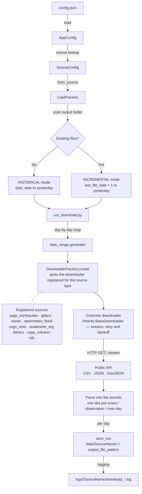

# GEO_Download

GIS Data Downloader — a Python 3.11 application for programmatically downloading geospatial data from public APIs and storing it as daily CSV files.

## Overview

GEO_Download fetches data from public geospatial APIs and saves it locally as dated CSV files. Currently supported sources:

| Source | API | Data |
|--------|-----|------|
| USGS Earthquake | [FDSN Event Query](https://earthquake.usgs.gov/fdsnws/event/1/query) | Seismic events (lat/lon, depth, magnitude, place) |
| GDACS | [GDACS REST API](https://www.gdacs.org/gdacsapi/swagger/index.html) | Global disasters — earthquakes, cyclones, floods, volcanoes, wildfires, droughts (country, alert level, severity) |
| NASA EONET | [EONET API v3](https://eonet.gsfc.nasa.gov/api/v3/) | Natural events — wildfires, storms, floods, volcanoes, earthquakes, drought, landslides, sea ice, temperature extremes (lat/lon, time-series tracks, magnitude) |
| Open-Meteo Flood | [Flood API](https://open-meteo.com/en/docs/flood-api) | Daily river discharge (m³/s) for 126 major world rivers (GloFAS model, historical from 1984 + 30-day forecast) |
| USGS NWIS | [WaterServices API](https://waterservices.usgs.gov/nwis/dv/) | Daily streamflow (ft³/s) from USGS stream gauges (site-specific, US only, decades of history) |
| Avalanche.org | [Avalanche.org API](https://api.avalanche.org/v2/public/products/map-layer) | Daily avalanche danger ratings (1-5) for 82+ forecast zones of 28 US avalanche centers (zone, center, travel advice) |
| IBTrACS | [NOAA IBTrACS](https://www.ncei.noaa.gov/products/international-best-track-archive) | Global tropical cyclone best-track data — storm position, wind speed, pressure, landfall info (all ocean basins, 1842-present) |
| USGS Volcano | [HANS API](https://volcanoes.usgs.gov/hans-public/api/volcano) | US volcano alert status — elevated alerts (ADVISORY/WATCH/WARNING) with observatory info and notice links |
| NIFC | [WFIGS ArcGIS](https://services3.arcgis.com/T4QMspbfLg3qTGWY/arcgis/rest/services/WFIGS_Interagency_Perimeters_Current/FeatureServer) | US wildland fire perimeters — incident name, location, acres, containment, jurisdiction |

All sources support two loading modes:

- **Historical** — bulk download from a configured start date to yesterday (initial load).
- **Incremental** — download only the days missing since the last downloaded file (catch-up runs).

The architecture is extensible: new data sources can be added by implementing a downloader class that inherits from `BaseDownloader`, without modifying the core orchestration logic.

## Features

- **Automated date management** — automatically determines historical vs incremental mode by scanning the output folder for existing files.
- **Day-by-day download** — each day's data is saved as a separate CSV, making files easy to manage and inspect.
- **Retry with backoff** — HTTP requests use exponential backoff (5 retries) with automatic retry on 429 and 5xx status codes.
- **Abstract base class** — `BaseDownloader` provides shared session setup, JSON fetching, and CSV parsing; new sources only implement `download_by_date_range()`.
- **Factory/Registry pattern** — new data sources are added via self-registering downloader classes.
- **Frozen Pydantic models** — all configuration and parameter objects are immutable.
- **Structured logging** — each run produces a timestamped log file under `logs/<SourceName>/`.
- **Fails on an empty run** — a run exits `0` only when at least one CSV was written (or the local data is already current); a run that requested days but saved nothing raises `RuntimeError` (traceback, exit code `1`), so a chained pipeline (GEO_E2E) stops instead of ingesting stale files.
- **CLI interface** — source selection via command-line arguments.

## Tech Stack

| Component        | Technology                                  |
|------------------|---------------------------------------------|
| Language         | Python 3.11                                 |
| Data Validation  | Pydantic >= 2.0.0                           |
| HTTP Client      | requests >= 2.31.0 (with urllib3 retry)     |
| CSV Processing   | Standard library `csv` + `io.StringIO`       |
| Testing          | pytest >= 7.0.0                             |
| Linting/Format   | ruff >= 0.6 (lint + format + import sort)   |
| Check runner     | tox >= 4.0 (isolated lint/test/typecheck)   |
| Type checking    | mypy (run via `tox -e typecheck`)           |
| Environment      | Conda                                       |

## Documentation

| Document | Contents |
|----------|----------|
| [Data sources](docs/data-sources.md) | Every CSV the app produces — file pattern, row grain and a field-by-field description of all 9 sources (174 IBTrACS columns included). |
| [Configuration](docs/configuration.md) | Full `config.json` reference — per-source settings, dates, output folders. |
| [Architecture](docs/architecture.md) | Project layout and how to add a new data source in 4 steps. |
| [Development](docs/development.md) | Running the tests, Ruff lint/format, tox environments and PyCharm integration. |

## Usage

### Setup

```bash
conda env create -f environment.yml
conda activate geo_download_311
```

### Run

```bash
python run_download.py <source_name>
```

Where `<source_name>` matches a key in `config.json` (e.g. `USGS_Earthquake`, `GDACS`, `EONET`, `OpenMeteo_Flood`, `USGS_NWIS`, `Avalanche_ORG`, `IBTrACS`, `USGS_Volcano`, `NIFC`).

Only enabled sources are accepted as valid arguments. The application will:

1. Load configuration from `config.json`.
2. Determine whether to run in historical or incremental mode by checking existing files in the output folder.
3. Download data for each day in the date range.
4. Save each day's data to a separate CSV file.

### Examples

**Earthquake data:**

```bash
python run_download.py USGS_Earthquake
```

```
---- USGS_Earthquake Downloader ----

Source name: USGS_Earthquake
Source type: usgs_earthquake
API URL: https://earthquake.usgs.gov/fdsnws/event/1/query
Output folder: data/USGS_Earthquake
Output file pattern: earthquakes_{date}.csv
Load type: INCREMENTAL
Start date: 2026-09-14 00:00:00
End date: 2026-09-13 00:00:00

Downloading data for 2026-09-14.
File data/USGS_Earthquake/usgs_earthquakes_2026-09-14.csv saved. Records: 142.

Done.
```

**Global disaster data (GDACS):**

```bash
python run_download.py GDACS
```

**Natural events (NASA EONET):**

```bash
python run_download.py EONET
```

**River discharge / flood monitoring (Open-Meteo Flood):**

```bash
python run_download.py OpenMeteo_Flood
```

**US streamflow (USGS NWIS):**

```bash
python run_download.py USGS_NWIS
```

**Global tropical cyclones (IBTrACS):**

```bash
python run_download.py IBTrACS
```

**USGS volcano alerts:**

```bash
python run_download.py USGS_Volcano
```

**US wildland fires (NIFC):**

```bash
python run_download.py NIFC
```

```
---- GDACS Downloader ----

Source name: GDACS
Source type: gdacs
API URL: https://www.gdacs.org/gdacsapi/api/Events/geteventlist/SEARCH
Output folder: data/GDACS
Output file pattern: disasters_{date}.csv
Load type: HISTORICAL
Start date: 2026-09-01 00:00:00
End date: 2026-09-14 00:00:00

Downloading GDACS events for 2026-09-01 to 2026-09-01.
  Page 1: 100 events
  Page 2: 47 events
Downloaded 147 GDACS events total
File data/GDACS/gdacs_disasters_2026-09-01.csv saved. Records: 147.

Done.
```

## Dataflow


